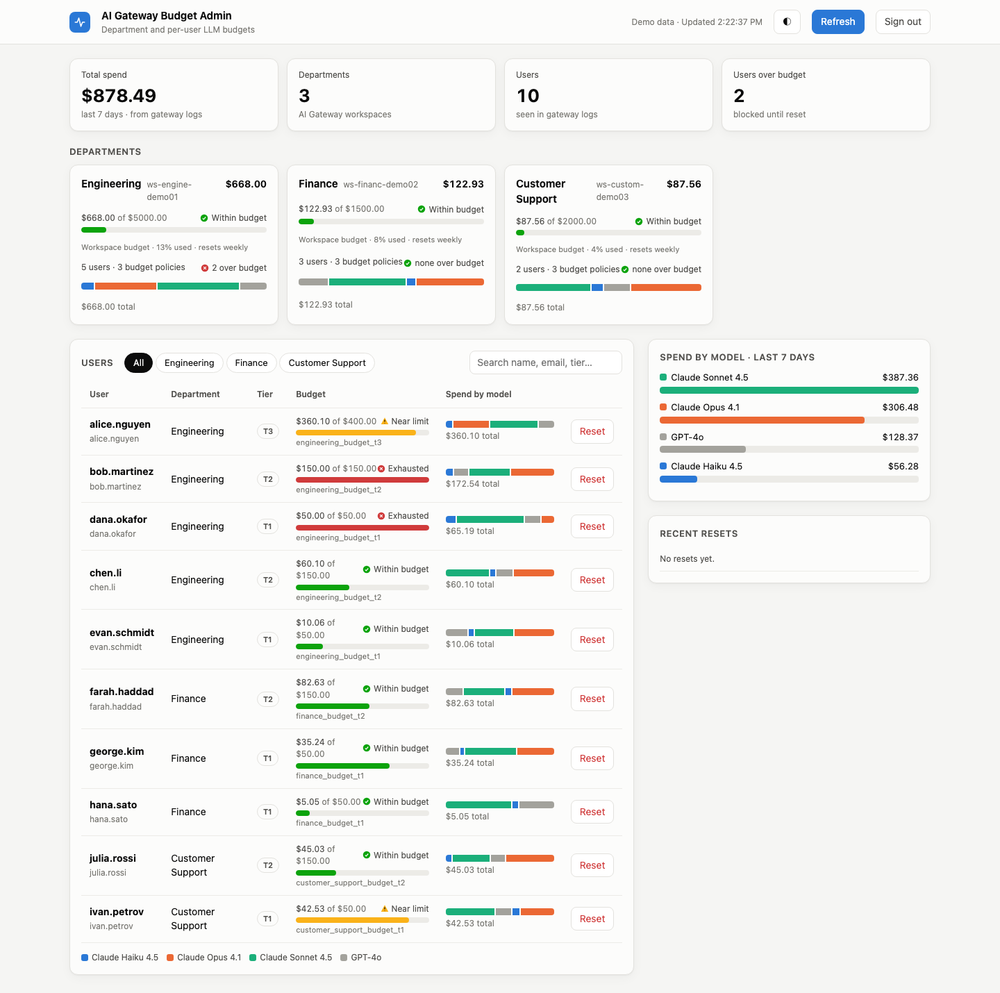
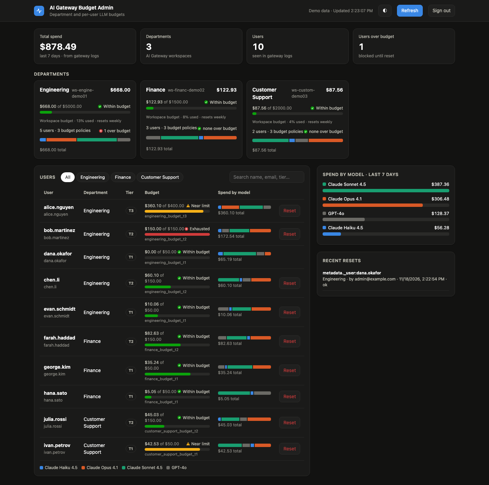
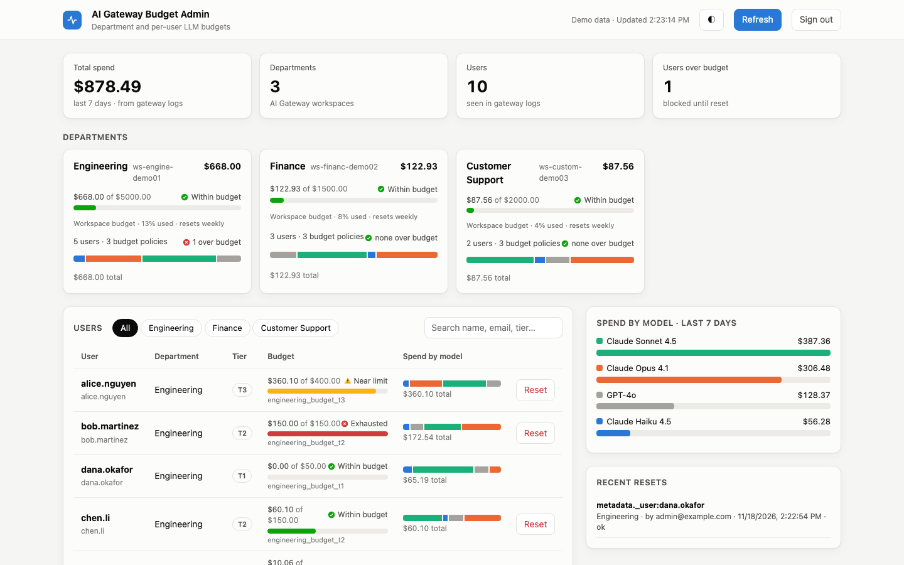
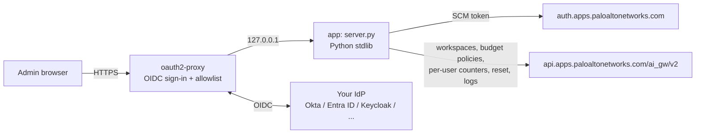

# AI Gateway Budget Admin

A small web dashboard for **Prisma AIRS AI Gateway** budgets. It shows, across the AI Gateway workspaces you choose:

- **Workspace budgets** (SCM *Budget Allocation*): limit, amount used, % and reset period.
- **Per-user budgets by tier**: every user's budget meter (within budget / near limit / exhausted), the tier policy
  that applies to them, and a **Reset** button that sets that user's counter back to $0 (confirmation + audit log).
- **Spend by model**, per user and per workspace, from the AI Gateway request logs.

It runs as one pod on your Kubernetes cluster, behind your own identity provider (OIDC) and an admin allowlist, and
talks only to the Prisma AIRS management API with a Strata Cloud Manager (SCM) service account.

> Community project, not an official Palo Alto Networks product or support offering. Use at your own risk (MIT).



<details><summary>Dark theme and reset audit</summary>



After resetting an exhausted user (counter back to $0, entry under *Recent resets*):



</details>

*Screenshots use the built-in demo data (`DEMO=true`); names and numbers are synthetic.*

## Features
| | |
|---|---|
| Workspaces ("departments") | One card per AI Gateway workspace: budget allocation meter, spend, users, policies, users over budget, model mix |
| Users | Name, workspace, tier badge, primary budget meter with status, spend by model, **Reset** per budget |
| KPIs | Total spend (window), workspaces, users, users over budget |
| Spend by model | Per workspace or all, last 7 days by default |
| Reset | Sets one user's counter under one budget policy to $0 in the live tenant; confirmation dialog; audit list + log line with the admin's email |
| Read-only switch | `READ_ONLY=true` (default) hides Reset and refuses the API call |
| Search / filters / theme | Search by name, email or tier; filter by workspace; light/dark |
| Demo mode | `DEMO=true` serves synthetic data, no tenant needed: preview the UI or show it before go-live |
| Security | OIDC sign-in (oauth2-proxy) + email allowlist; app listens on localhost inside the pod; non-root, read-only file system, Pod Security `restricted`; secrets only in Kubernetes Secrets |

## How it works

Details: [docs/HOW-IT-WORKS.md](docs/HOW-IT-WORKS.md).

## Requirements
| Area | What you need |
|---|---|
| Prisma AIRS | AI Gateway in Strata Cloud Manager, with the workspaces to monitor. Budget data comes from the workspace **Budget Allocation** and **usage-limit (budget) policies**; per-user tier budgets need policies grouped by `metadata._user` with a condition on a tier metadata key (e.g. `metadata.jwt_tier`) |
| SCM service account | Client ID + secret + TSG ID, with a role that can read AI Gateway workspaces, budget policies and logs (and reset budget counters if you enable Reset) |
| Kubernetes | 1.25+; permission to create a namespace, Secrets, ConfigMaps, a Deployment, a Service (and an Ingress); Pod Security `restricted` compatible |
| Network (egress from the pod) | HTTPS to `auth.apps.paloaltonetworks.com`, `api.apps.paloaltonetworks.com`, your IdP issuer; image pulls for `python:3.12-slim` and `quay.io/oauth2-proxy/oauth2-proxy` (or mirrors) |
| Exposure | An ingress controller + TLS certificate for a hostname (recommended), or a LoadBalancer |
| Identity provider | Any OIDC provider where you can create a confidential web app (authorization code + PKCE) |
| Workstation | `kubectl`, `python3` 3.8+, `bash`; no build step, no Docker required |

## Quick start
**Preview locally with demo data (1 minute, no tenant):**
```bash
git clone https://github.com/djspears/aigw-budget-admin.git && cd aigw-budget-admin
DEMO=true READ_ONLY=false python3 app/server.py      # then open http://127.0.0.1:8080
```
(Local runs have no sign-in; the server binds to 127.0.0.1 only.)

**Deploy to Kubernetes:**
```bash
python3 tools/list_workspaces.py   # with SCM_TSG_ID/SCM_CLIENT_ID/SCM_CLIENT_SECRET set: checks access, prints DEPARTMENTS
cp deploy/config.env.example deploy/config.env && chmod 600 deploy/config.env   # fill it in
./deploy/deploy.sh --dry-run       # review the manifests (secrets redacted)
./deploy/deploy.sh                 # apply and wait for the rollout
```
Full walkthrough, including the SCM service account, IdP app (Okta, Entra ID, Keycloak) and TLS:
**[docs/DEPLOYMENT.md](docs/DEPLOYMENT.md)**.

## Documentation
| Doc | Contents |
|---|---|
| [docs/DEPLOYMENT.md](docs/DEPLOYMENT.md) | Prerequisites checklist and the full step-by-step deployment, verification, enabling resets, upgrades, uninstall |
| [docs/CONFIGURATION.md](docs/CONFIGURATION.md) | Every `config.env` setting and app environment variable |
| [docs/HOW-IT-WORKS.md](docs/HOW-IT-WORKS.md) | Data model, API calls, how numbers are computed, security model |
| [docs/TROUBLESHOOTING.md](docs/TROUBLESHOOTING.md) | Symptoms and fixes |

## Repository layout
```
app/server.py                  backend + JSON API (Python standard library only)
app/demo.py                    synthetic data for DEMO=true
app/static/index.html          single-page UI (no external assets)
oauth2-proxy-templates/        sign-in and error pages
deploy/config.env.example      deployment settings template
deploy/deploy.sh, render.py    render manifests from config.env and apply them
deploy/templates/              Deployment, Service, Ingress templates
tools/list_workspaces.py       verify the service account and list workspaces/budgets
Dockerfile                     optional container image (not required by deploy/)
```

## License
[MIT](LICENSE) © 2026 David Spears
